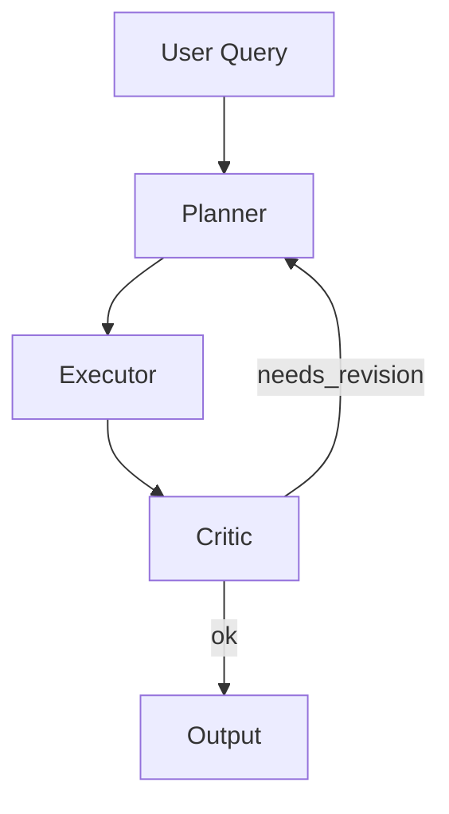

# /visualize — アーキテクチャ・フロー可視化

指定されたコード、プロトコル、またはシステムの構造を視覚的に表現してください。

## 可視化タイプ

### 1. ASCII アート（ターミナル即時表示）
```
┌──────────┐     ┌──────────┐     ┌──────────┐
│  Input   │────▶│  Agent   │────▶│  Output  │
└──────────┘     └──────────┘     └──────────┘
```
- シンプルな関係図やフロー図に最適
- ターミナル上で即時表示

### 2. Mermaid ダイアグラム（Markdown 埋め込み）

- Obsidian や GitHub で直接レンダリング
- 複雑なフローに推奨

### 3. HTML プレゼンテーション
- 大規模アーキテクチャの説明用
- アニメーション付きスライド
- 保存先: `C:\obsidian\Obsidian\Dev_Logs\`

## 使い方

以下のいずれかの形式で依頼:
- 「このファイルのアーキテクチャを可視化して」
- 「agent_hello.py の処理フローをシーケンス図で描いて」
- 「Plan-and-Execute の状態遷移を図にして」
- 「プロジェクト全体の依存関係をMermaidで描いて」

## 出力ルール

1. **ラベル必須**: すべてのノードとエッジにラベルを付ける
2. **凡例**: 要素が5つ以上の場合は凡例を追加
3. **色分け**: 成功=緑、失敗=赤、進行中=黄色
4. **保存**: Mermaid/HTML は Obsidian Dev_Logs に保存して永続化
